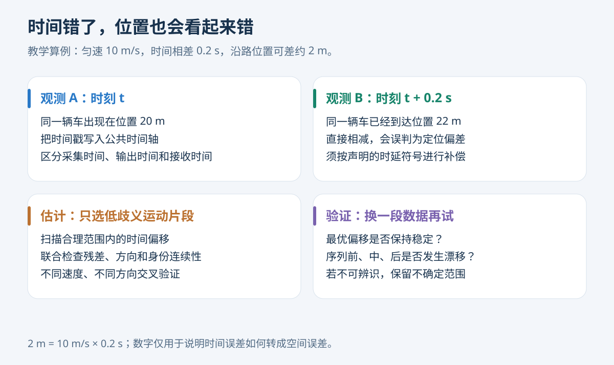
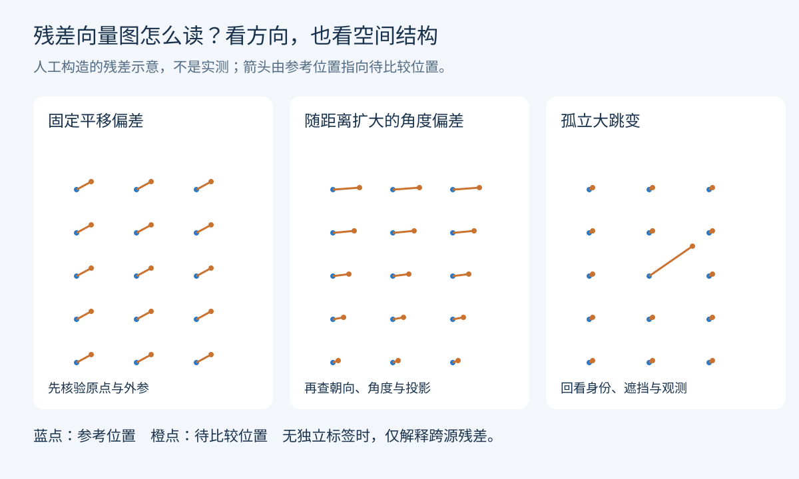
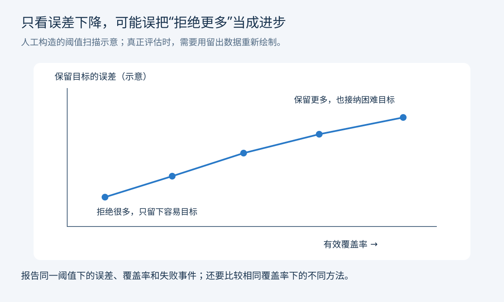

雷达位置不准，能不能以视觉定位为主，只借雷达的速度和连续性？**可以作为待验证的方案，但不能把“视觉一定准、雷达速度一定准”当作前提。**

更实用的做法是：把雷达拆成几份证据，分别判断目标是否存在、位置是否可信、速度是否有帮助，以及这次是否配对到了同一辆车。本文从只有目标级轨迹、没有置信度的输入出发，给出可以照着做的数据分析流程。

<!-- more -->

> 本文是方法教程，不是实验结果报告。所有插图均为原创方法示意；算例数字均为虚构。公开论文与数据集保留真实名称。本文不展示现场原始图像、设备信息或采集记录。

## 1. 先回答最直接的问题：为什么不能一律相信视觉？

摄像头擅长识别车辆、类别和图像中的轮廓，但“框画得准”不等于“地面坐标准”。单目图像投影到地面时，地面坡度、相机俯仰、车辆底部接触点和遮挡都会影响定位。远处几个像素的误差，可能对应明显的地面偏差。

雷达也不是一个完整可靠或完整不可靠的整体。距离、横向位置、径向速度和厂商输出的二维速度，误差来源可能不同。尤其要注意：**目标列表中的 vx、vy 往往是跟踪器的估计值，不能直接当成独立、准确的多普勒观测。**

因此，“视觉给位置，雷达给速度”应该通过对照实验成为结论。若某些区域雷达距离更稳定，就可以只约束相应方向；若视觉在这些区域更准，则降低雷达位置的影响。不要先决定谁当主角，再挑支持它的样本。

这里还要区分四种量：**可靠性特征**描述过去是否稳定；**定位不确定度**描述位置误差范围；**关联概率**描述是否配对正确；**存在概率**描述目标是否真实存在。它们不能用同一个未经校准的“置信度”替代。

## 2. 先建立一张最小数据表

目标级输入足以做很多诊断，不必等到拿到点云。第一步是统一字段含义，而不是把所有数据立刻塞进滤波器。

| 字段组 | 至少保留什么 | 主要检查 |
|---|---|---|
| 时间 | 原始时间戳、公共时间、接收时间（若有） | 单位、时区、延迟、乱序、重复 |
| 身份 | 传感器来源、原始目标 ID | ID 是否复用，是否在重启后归零 |
| 位置 | 原始坐标、统一坐标、有效标记 | 单位、轴方向、原点、中心定义 |
| 速度 | 有效分量、坐标系、速度类型 | 径向还是二维；缺失不能填零 |
| 可选属性 | 类别、尺寸、目标级强度 | 定义、缺失码、饱和与更新频率 |
| 分析结果 | 配对候选、残差、拒绝原因 | 与原始字段分开，保留可追溯性 |

不要覆盖原始时间和坐标。每次变换都记录版本，才能区分“传感器变好了”和“解析错误终于修好了”。输出列表也可能已经经过上游融合；若来源不是独立雷达，就不能拿它证明新增雷达的独立贡献。

建议准备三张表：逐帧观测表、逐轨迹汇总表、逐事件复核表。事件表记录“何时、何处、哪两个候选、为何拒绝或接受”。这样看见指标异常时，可以直接回到具体片段。

## 3. 第一轮分析：六个维度，六张图

### 3.1 数据完整性：先查有没有读错

按通道绘制时间轴，标出缺帧、重复、乱序以及每帧目标数。分别统计“传感器整帧没来”和“这一帧来了，但某辆车没有观测”，两者不能混成目标漏检。

还要看数据年龄：一条看起来平滑的轨迹，如果已经延迟很久，就不能作为当前时刻的位置直接使用。名义输出频率也不等于独立信息频率，设备可能重复发送同一状态。

### 3.2 时间对齐：先解释随速度变化的误差

一个直观算例：车辆以 10 m/s 匀速行驶，两个时间戳相差 0.2 s，即使定位都正确，直接叠加也可能差约 2 m。这个数只说明机制，不是任何实测结论。

可在低歧义、持续运动的片段上扫描时延，同时看空间残差、速度方向和配对连续性。扫描范围根据设备时间语义与链路延迟确定；例如正负 300 ms、步长 10 ms 只能作为初始试探，不能当通用配置。

明确符号：若比较雷达在 t 时刻的状态与视觉在 t+δ 时刻的状态，就记录这个定义，避免补偿方向弄反。估计后锁定参数，在另一段未参与估计的数据上验证；再检查序列前、中、后的最优时延是否变化。

**不要只优化最近邻距离。** 密集排队时，错配到相邻车辆也能获得很小残差。停车时则缺少足够运动激励，时间偏移可能根本不可辨识。固定延迟、坐标偏差和参考点偏差有时互相混淆，需要不同速度、不同方向的片段来拆解。

### 3.3 空间一致性：横向、纵向要分开

统一坐标后，把残差投影到道路纵向与横向，分别报告中位数、P90/P95、有效样本数。均值不能替代尾部风险：大部分时候正常、偶尔跳到邻车，对跟踪系统仍然很危险。

全区域同向偏移，提示原点或外参问题；远距离扇形偏差，提示角度、朝向或投影问题；随车辆朝向变化的偏差，提示雷达反射点和车辆中心不同。这些只是候选解释，要用独立参照或对照试验排除其他原因。

没有独立真值时，正确名称是“雷视位置残差”，不是“雷达定位误差”。两者一致也不保证两者都正确，尤其当两路数据共享上游估计或标定时。

### 3.4 单条轨迹：既看连续性，也看错误连续性

计算轨迹寿命、观测命中率、最大缺测间隔、跳变、速度变化和道路区域内比例。命中率的分母应是目标处于有效可观测范围内的预期时刻；不能把离开视野后的时间算漏检。

ID 重建要有跨片段身份依据。单凭一个 ID 消失、附近另一个 ID 出现，最多先记“疑似重建事件”。完整轨迹寿命可以用于离线诊断，在线决策只能使用当前年龄，不能偷看未来。

“速度曲线很平”也不够。固定滞后的速度、错误车道中的平滑鬼影，都可能很稳定。更有意义的验证是：在相同起点和预测模型下，加入雷达速度后，未来 0.5 s、1 s 的位置预测误差是否下降。参考必须独立；若用未来视觉位置作参考，只能先得到相对视觉的预测一致性。

### 3.5 关联：有没有把邻车配成同一辆？

先用时间、空间、运动方向和有效道路区域生成候选，再做允许“不匹配”的一对一分配。停车目标的朝向可能不可用，不要硬用；无可靠类别时，也不应把类别当硬门槛。

除最终配对外，保存第一和第二候选的代价差、配对切换次数和拒绝原因。差距很小，意味着存在歧义，此时先不融合比贸然更新更合理。

只在成功匹配的目标上画残差，会把难样本全部排除，形成选择偏差。因此每张残差图旁都要给出匹配率、拒绝率和样本组成。视觉没有匹配到雷达，可能是遮挡、夜间失检或视野不重合，不能直接记成雷达假目标。

### 3.6 边际收益：用了这条信息，究竟改善了什么？

先固定纯视觉基线，再分别加雷达位置、雷达速度，最后加自适应策略。使用相同评估范围、相同检测输入和相同调参预算。把“定位变准”“身份更稳”“预测更好”分开，不能用 ID 数量更接近标签数量来代表全面提升。

## 4. 分组分析：平均值会藏住哪些问题？

| 分组维度 | 为什么要分 | 优先观察 |
|---|---|---|
| 距离与方位 | 误差具有方向性，远近信息条件不同 | 横纵向尾部残差、有效覆盖率 |
| 运动状态 | 停车、直行、转弯依赖不同模型 | 时延可辨识性、加速度和预测误差 |
| 遮挡与可见程度 | 未匹配不等于目标不存在 | 恢复时间、假续接、缺测时长 |
| 交通密度 | 邻车竞争增加关联错误 | 配对切换、身份切换、拒绝率 |
| 目标类别与尺寸 | 反射点和中心偏差可能不同 | 系统偏差、尺度相关误差 |
| 会话、天气与光照 | 存在域偏移 | 分布变化、策略是否仍有效 |

先做单维和少量关键二维分组，例如“距离×遮挡”，不要一次把所有维度交叉到每格只剩几个样本。每格同时报告独立轨迹数和帧数；同一辆车的一千帧，不等于一千个独立样本。

估计区间时，按轨迹或连续片段做配对重采样，比把帧独立打散更合理。若只有少数采集会话，应明确泛化证据有限。某格数据太少就标“证据不足”，不要强行填一个可靠性分数。

## 5. 多了一个强度字段，应该怎么用？

若设备提供每个目标的强度标量，第一件事是查定义：它是幅度、功率、RCS、峰值，还是厂商自定义量？单位和含义未知时，不要套用未经验证的距离补偿公式。

**一个强度标量不是点云。** 不能从它推导出点数、空间散布、目标内部反射结构。可以做的是当前强度、过去窗口中位数、波动、突降和饱和比例等时间特征。

强度容易与距离、车型和角度混在一起。若高强度目标大多在近处，它们误差较小，未必说明强度带来了额外信息。应在相近距离、方位和类别内比较，或先建立不含强度的基线，再观察新增强度是否有留出集增益。

至少做三组：不用强度、用真实强度、在条件分箱内打乱强度。随机打乱只用于对照，不是部署操作。若真实强度不优于打乱组，不能证明它提供了稳定的额外信息。

归一化和分箱边界只用训练数据估计。遇到新设备或新会话，还要检查缺失、饱和和分布变化。强度高的鬼影仍可能存在，所以强度至多是证据之一，不是放行开关。

## 6. 没有置信度，如何得到可用性判断？

最初可以不用复杂网络，先做可审计规则：数据是否新鲜、最近是否大跳、当前关联是否有竞争、当前场景是否有验证证据。输出“允许位置”“允许速度”“仅维持存在”“暂缓关联”等权限，并记录原因。

有了独立标注后，再分别建立三个任务：位置误差是否超过业务容忍范围；速度是否改善给定时域的预测；配对是否正确。错误配对不应悄悄进入“定位噪声”训练样本，而应单独作为关联失败。

阈值由业务要求和验证集选择，不应来自文章中的演示数字。如果把模型输出称为概率，需要检查预测概率与实际发生率是否对应；没有做校准的打分只能叫风险分数。

滤波实现上，速度单独可用就只更新相应速度观测，不要同时把可疑位置塞进去。定位噪声也应区分方向，而非用一个标量概括所有误差。固定偏差先处理，单纯增大噪声不能消除偏差。

厂商轨迹已经经过滤波，相邻输出具有时间相关性。若把每帧当独立测量反复更新，可能让协方差虚假收缩。应核验实际更新频率与创新相关性，谨慎设置噪声。协方差交集等方法可处理部分未知相关性问题，但前提仍是合理的不确定度描述，它不能自动纠正错配与系统偏差。

## 7. 夜间视觉差，雷达到底怎么接？

先区分三种状态：**有持续有效雷达观测、只有部分可靠雷达分量、没有有效新观测。**

第一种可以继续进行观测更新，不应机械地规定“摄像头一消失，几秒后必须删掉”。第二种例如只剩可靠速度，可更新速度，但位置不确定度仍会增长，是否继续输出取决于业务容忍范围。第三种才是纯预测，需要有限的续航时间或不确定度上限。

已有轨迹维持与新目标生成也应分开。已有身份可以沿用历史证据，新目标则需要更严格的多帧确认和场景一致性。类别可以暂存，但要标记它已经多久没有得到视觉更新；目标存在不等于类别仍然可靠。

视觉恢复后，先检查是否还是同一辆车，再进行有门控的校正。策略切换加迟滞：明显异常可以快速降权，恢复则要求连续证据，避免明暗交替时反复切换。

人工调暗白天图像、删除检测或模拟遮挡，只能测压力下的行为。它们没有覆盖真实夜间的眩光、曝光和分布变化，不能据此宣称夜间效果已被证明。

## 8. 怎样使用 ES-MEOT 做公平对照？

公开的 [ES_MEOT data](https://data.mendeley.com/datasets/k2kggnrtxg/1) 发布页列出了视频、雷达轨迹、雷达点云、标注与配置，并注明对应论文为 *3D Multiple Extended Object Tracking by Fusing Roadside Radar and Camera Sensors*。公开名称和数据说明可以正常引用。

使用前核验标注的坐标、尺寸、时间、目标参考点和可评估区域。不要因为文件名含 annotation，就假设其格式适配自己的评估器。若自行切分训练、验证、测试，必须明确称为自定义划分，不能称为官方划分。

按会话或连续片段切分，并避免同一轨迹跨集合、时间窗口跨边界。若数据量只能支持同序列留出，应说明它验证的是该序列内的表现，不能替代跨场景泛化。

实验分成两张表：第一张是**相同目标级输入**下的消融；第二张是允许点云、关键点等额外信息的完整方法比较。信息预算不同，要单独标注，不能把额外输入带来的收益全算成融合算法的优势。

| 对照组 | 改变的部分 | 回答的问题 |
|---|---|---|
| A 纯视觉；B 纯雷达 | 仅保留一种传感器 | 单源各自在哪里失败？ |
| C 视觉加雷达位置 | 增加位置信息 | 哪些空间区域受益或恶化？ |
| D 视觉加雷达速度 | 增加速度信息 | 未来预测与遮挡关联是否改善？ |
| E 固定融合；F 自适应融合 | 改变信息使用策略 | 自适应是否优于固定权重？ |
| F 加真实/打乱强度 | 只改变强度特征 | 强度是否有额外价值？ |

结果至少包含定位误差、预测误差、FP/FN、身份切换、轨迹碎片、有效覆盖率和计算延迟。采用 HOTA、IDF1 时，应使用经过验证的实现，声明匹配空间和距离门槛，不能把自定义“ID 接近程度”叫作标准身份指标。

先在验证集决定策略，再对测试集做固定评估。保留完整失败片段，尤其是融合比纯视觉更差的样本。若只降低了已接受目标的误差，却拒绝了大量困难目标，应同时报告这笔代价。

## 9. 一个走完整条流程的例子

以下全部为虚构教学数值：某条件下，雷视位置相差约 3 m。第一步核验时间、坐标和目标参考点；第二步确认没有配对到邻车；第三步在独立标注上发现视觉位置确实更准。

接着固定预测起点与模型，在留出片段上比较：纯视觉的一秒预测误差为 1.8 m；加入雷达速度后为 0.9 m。这里才有理由说：**在这个已验证条件下，雷达速度有用，但位置暂时不该进入更新。**

如果随后视觉缺测，但雷达仍持续提供有效位置与速度，可以继续观测更新。如果位置仍然不可信、只有速度可用，则位置不确定度继续增长；不能因为每帧还有一个速度值，就假装位置始终精准。若两路都没有有效观测，再进入有限时长的预测。

这个例子不能证明任何总体提升，它只是说明决策链需要哪些证据。实际验收还要检查转弯、远距离、并行车辆和遮挡恢复，防止某个分组的收益掩盖另一个分组的错误。

## 10. 从文献里借什么，不该照搬什么？

下面是围绕这个问题的定向阅读，不是覆盖全部论文的系统综述。

| 公开研究 | 值得借鉴的思路 | 迁移到目标级输入时的限制 |
|---|---|---|
| [CenterFusion](https://arxiv.org/abs/2011.04841) | 用关联后的雷达信息补充视觉的深度与速度 | 它研究 3D 检测及中间特征融合，不等同厂商轨迹后融合 |
| [路侧稀疏雷达与像素关键点扩展目标跟踪](https://arxiv.org/abs/2404.17903) | 显式建模反射点与目标外形的关系 | 依赖稀疏点云和视觉关键点；一个强度标量不足以实现该模型 |
| [RADIATE](https://arxiv.org/abs/2010.09076) | 在夜间及恶劣天气等条件下分组研究 | 使用高分辨率雷达图像等输入，不能直接代表目标列表系统 |
| [ES-MEOT 公开数据](https://data.mendeley.com/datasets/k2kggnrtxg/1) | 提供带标注的路侧雷视对照资源 | 需核对输入预算、标签语义与自定义切分 |

其中 2024 年的路侧扩展目标论文与 ES-MEOT 发布页所列多目标论文，题名不同，不应混称为同一份完整复现。文献能支持“哪些信息值得建模”的判断，最终系统是否受益，仍要由自己的同条件对照决定。

## 11. 最后应该交付什么？

一份可执行成果应包含：字段和坐标说明；时间同步与残差诊断；按距离、遮挡和运动状态划分的质量表；独立标注子集；可复跑的消融配置；带原因的失败事件清单。

第一轮优先解决解析、时钟和坐标；第二轮解决关联与小规模独立标注；第三轮才比较“位置、速度、强度各自增加了多少收益”。这三个阶段以证据过关，不以调了多少参数过关。

真正有用的结论会很具体：**在什么条件下，允许雷达贡献哪一维信息；证据不够时怎么降级；何时停止使用。** 这样才能把“雷达不准”变成可定位、可验证、可改进的问题。
